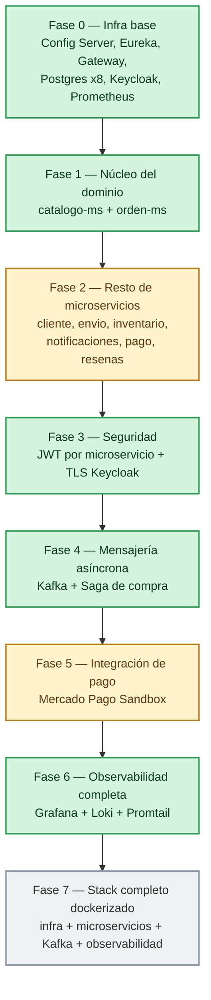

# Estado de avance

Foto del proyecto al **2026-10-28** (cierre de la Unidad II, S06–S11): qué está implementado y corriendo, qué es solo esqueleto, y qué falta. Se actualiza a medida que avanza cada fase del [Roadmap](#roadmap).

## Resumen

| Componente | Estado | Detalle |
|---|---|---|
| Config Server (`nextlook-config`) | ✅ Implementado | Sirve configuración a todos los demás desde [infra/config-repo](../infra/config-repo) y `services/*/config`. |
| Eureka (`nextlook-eureka`) | ✅ Implementado | Service Registry; `orden-ms` resuelve `cliente-ms` y `catalogo-ms` por nombre. |
| Gateway (`nextlook-gateway`) | ✅ Implementado | Rutas `/api/v1/**` + **validación JWT y reglas por rol** (1ra línea de defensa, S07). |
| `catalogo-ms` | ✅ Implementado (U2) | Categorías, prendas, variantes talla/color, datos semilla. |
| `cliente-ms` | ✅ Implementado (U2) | Perfil ligado al JWT + direcciones de envío. |
| `orden-ms` | ✅ Implementado (U2) | Feign + Circuit Breaker (S06), evento `orden.creada` (S08), Saga (S09). |
| `inventario-ms` | ✅ Implementado (U2) | Reserva todo-o-nada idempotente, confirmación y compensación. |
| `pago-ms` | 🟡 Implementado con pasarela simulada | Flujo de eventos completo; falta conectar Mercado Pago Sandbox real. |
| `resenas-ms`, `envio-ms`, `notificaciones-ms` | 🟡 Esqueleto protegido | Validan JWT (401/403) igual que el resto; su lógica de negocio queda para U3. |
| Seguridad (Keycloak / JWT) | ✅ Implementado | Realm `nextlook` importado automáticamente; Gateway + cada servicio implementado validan el token (ver [Seguridad](seguridad.md)). TLS real pendiente. |
| Mensajería asíncrona | ✅ Kafka 4 (KRaft) | Topics `orden-eventos`, `inventario-eventos`, `pago-eventos` + Kafka UI (ver [Comunicación](comunicacion.md)). |
| Consistencia distribuida | ✅ Saga coreografiada | Consumidores idempotentes y compensación (ver [Consistencia](consistencia.md)). |
| Cliente web (S11) | ✅ Implementado | SPA Angular 22 en `frontend/`: login PKCE contra Keycloak, catálogo, bolsa, perfil, «Mis pedidos» con *polling* y pago (ver [Cliente web](frontend.md)). |
| Observabilidad (S10) | ✅ Implementado | Prometheus (+ Keycloak), Loki/Promtail, Grafana con el tablero *NextLook - Diagnostico*, health groups y `X-Trace-ID` de punta a punta (ver [Observabilidad](observabilidad.md)). |

## Cómo levantar todo (dev)

```bash
docker compose \
  -f docker/docker-compose.infra.yml \
  -f services/compose-dev.yml \
  -f obs/compose-dev.yml \
  up -d --build
```

Levanta: Config Server, Eureka, Gateway, Keycloak (con el realm `nextlook` ya importado), Kafka + Kafka UI, una base Postgres por microservicio, los 8 microservicios y Prometheus (definidos en `docker/docker-compose.infra.yml`, `services/compose-dev.yml` y `obs/compose-dev.yml`).

| Servicio | URL |
|---|---|
| Gateway | http://localhost:18080 |
| Eureka | http://localhost:18761 |
| Config Server | http://localhost:18888 |
| Prometheus | http://localhost:19090/targets |
| Grafana | http://localhost:13000 (admin / admin) |
| SPA (Angular, `npm start`) | http://localhost:4200 |
| Keycloak | http://localhost:18443 (realm `nextlook`) |
| Kafka UI | http://localhost:18085 |
| catalogo-ms | http://localhost:8081 |
| inventario-ms | http://localhost:8082 |
| resenas-ms | http://localhost:8083 |
| orden-ms | http://localhost:8084 |
| pago-ms | http://localhost:8085 |
| cliente-ms | http://localhost:8086 |
| envio-ms | http://localhost:8087 |
| notificaciones-ms | http://localhost:8088 |

Cada microservicio expone `/actuator/health` y `/swagger-ui.html`.

## Roadmap

Fases 1, 2, 3, 5 y 7 vienen de los comentarios "Placeholder... ver Fase N" ya presentes en `services/*/config/*.yml` y en `docker/docker-compose.infra.yml`. Las fases 4 y 6 no están definidas en ningún documento del equipo todavía — se muestran acá como **propuesta** para llenar el hueco lógico entre "negocio" (fase 2), "pagos" (fase 5) y "stack completo" (fase 7); hay que confirmarlas con el equipo, no darlas por definitivas.



- 🟢 **Fases 0, 1, 3 y 4 — hechas**: infraestructura, núcleo (`catalogo-ms` + `orden-ms`), seguridad JWT de dos líneas y mensajería Kafka con la Saga de compra.
- 🟡 **Fase 2 — en progreso**: `cliente-ms`, `inventario-ms` y `pago-ms` listos; faltan `resenas-ms`, `envio-ms`, `notificaciones-ms`.
- 🟡 **Fase 5 — en progreso**: `pago-ms` ya cobra y publica eventos, con pasarela simulada; falta la API real de Mercado Pago Sandbox.
- 🟢 **Fase 6 — hecha (S10)**: Grafana + Loki + Promtail con tablero de diagnóstico. ⬜ **Fase 7 — pendiente**.

## Prueba rápida de la Saga

Con todo levantado: `pwsh scripts/prueba-saga.ps1` (Windows PowerShell 5+ o PowerShell 7). Recorre tres casos: compra pagada (`APRO`), pago rechazado (`FUND`, con compensación de stock) y orden sin stock (zapatillas talla 42 negro, stock 0).

## Qué falta para que cada fase esté "hecha"

| Fase | Para darla por completa hace falta |
|---|---|
| 1 | Entidades + repositorios + controladores REST de `catalogo-ms` y `orden-ms`, con sus endpoints documentados en [microservicios/](microservicios/orden-ms.md). |
| 2 | Lo mismo para `cliente-ms`, `envio-ms`, `inventario-ms`, `notificaciones-ms`, `pago-ms`, `resenas-ms`. |
| 3 | Cada microservicio validando JWT de Keycloak (Spring Security OAuth2 Resource Server) + TLS real en Keycloak. |
| 4 | Elegir la tecnología de mensajería y publicar/consumir los eventos de [Comunicación](comunicacion.md). |
| 5 | `pago-ms` llamando a la API real de Mercado Pago Sandbox (ver [Integración de pago](integracion-pago.md)). |
| 6 | `obs/compose-dev.yml` con Grafana + Loki + Promtail levantados y con dashboards reales. |
| 7 | Un solo `docker-compose` de producción local con todo junto (hoy son 3 archivos combinados a mano). |
