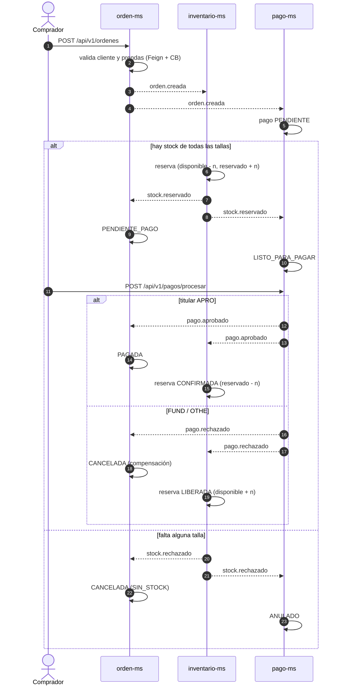

# Consistencia de datos — Saga de compra (S09)

No hay transacción distribuida: cada servicio confirma en **su** base y avisa con un evento. Si un paso falla, los servicios anteriores **compensan**. Es una Saga **coreografiada** (nadie la orquesta: cada servicio reacciona a los eventos).

## Estados

| Servicio | Estados |
|---|---|
| `orden-ms` | `CARRITO` → `PENDIENTE_STOCK` → `PENDIENTE_PAGO` → `PAGADA` / `CANCELADA` |
| `inventario-ms` (`reserva_stock`) | `RESERVADA` → `CONFIRMADA` / `LIBERADA` |
| `pago-ms` | `PENDIENTE` → `LISTO_PARA_PAGAR` → `APROBADO` / `RECHAZADO`; `ANULADO` |

## Idempotencia (Kafka entrega "al menos una vez")

| Consumidor | Capa 1 (consulta) | Capa 2 (base de datos) |
|---|---|---|
| `inventario-ms` ← `orden.creada` | `orden_procesada.findByOrdenId` | `UNIQUE(orden_id)` en `orden_procesada` + `UNIQUE(orden_id, variante_id)` en `reserva_stock` |
| `pago-ms` ← `orden.creada` | `pagos.findByOrdenId` | `UNIQUE(orden_id)` en `pagos` |
| `orden-ms` ← stock / pago | guarda por estado actual (solo `PENDIENTE_STOCK` acepta `stock.*`, solo `PENDIENTE_PAGO` acepta `pago.*`) | — |
| `inventario-ms` ← `pago.*` | solo reservas en `RESERVADA` se confirman o liberan | — |

La compensación usa **la misma guarda** que el camino feliz: un `pago.rechazado` repetido no devuelve el stock dos veces, porque la reserva ya está en `LIBERADA`.

Si la violación de `UNIQUE` ocurre (dos entregas al mismo tiempo), el listener atrapa `DataIntegrityViolationException`, la transacción completa se revierte y el evento se registra como `status=ignored`.

## Eventos que llegan "fuera de turno"

Son topics distintos, así que Kafka no garantiza el orden entre ellos. Dos casos se resuelven con reintento (`DefaultErrorHandler`, 5 intentos cada 2 s):

- `pago-ms` recibe `stock.*` antes que `orden.creada` → `PagoAunNoRegistradoException`.
- `orden-ms` recibe `pago.*` mientras la orden sigue en `PENDIENTE_STOCK` → `EventoFueraDeSecuenciaException`.
