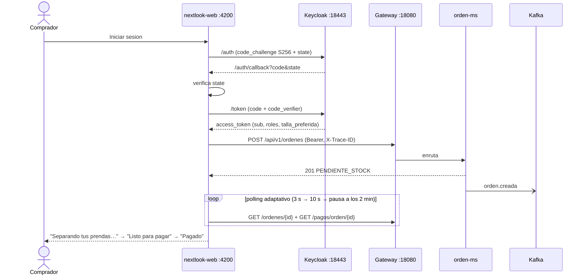

# Cliente web (S11)

SPA **Angular 22** en `frontend/` que entra al sistema solo por el **Gateway** y se autentica en **Keycloak** con *Authorization Code* + PKCE. Detalle de pantallas y arranque en [frontend/README.md](../frontend/README.md).

## Decisiones

| Tema | Decisión |
|---|---|
| Cliente OIDC | `nextlook-web`: público, solo *standard flow*, `pkce.code.challenge.method = S256`, **sin** *direct access grants*. `nextlook-api` queda solo para los scripts `.ps1` (password grant, sin redirect URIs). |
| Tokens | En memoria (signal). `code_verifier` y `state` en `sessionStorage` solo durante la ida y vuelta, borrados al usarse. |
| Dueño de órdenes y pagos | `sub` del JWT (`keycloak_id` en `cliente-ms`, `ordenes` y `pagos`): no hace falta *mapper*. |
| Dato de negocio propio | `talla_preferida`: *user attribute* declarado en el *user profile* del realm + *protocol mapper* `talla-preferida` (access, id y userinfo token). La SPA preselecciona esa talla en el catálogo. |
| CORS | Un solo `CorsConfig` en el Gateway (WebMVC) para `/api/**`, origen `http://localhost:4200`, expone `X-Trace-ID`. Ningún microservicio configura CORS. |
| Estado "todavía no se sabe" | *Polling* adaptativo en «Mis pedidos»: solo pedidos en tránsito, 3 s → 10 s tras 30 s → se detiene a los 2 min con aviso; pausa con la pestaña oculta; se limpia al salir. |
