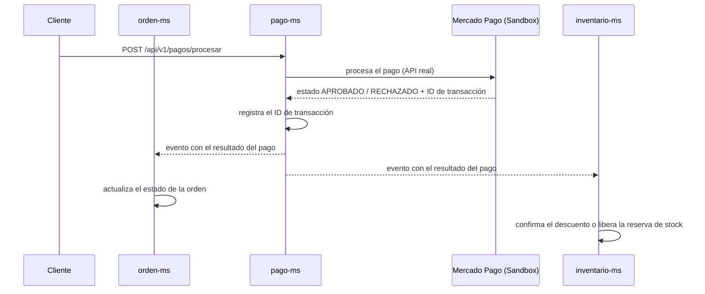

# Integración de pago

`pago-ms` debe integrar la API real de Mercado Pago (Sandbox).

!!! info "Estado actual (U2)"
    El flujo de eventos ya está completo, pero la pasarela es **`PasarelaSimulada`**: decide el resultado con la convención de titulares de prueba de Mercado Pago (`APRO` aprobado, `FUND` fondos insuficientes, `OTHE` rechazado) y genera un `idTransaccion` `SIM-…`. Para conectar la API real solo hay que implementar la interfaz `PasarelaPago`; el resto del servicio no cambia.



La llamada `pago-ms → Mercado Pago` es síncrona (petición directa a la API externa). Los avisos de `pago-ms` hacia `orden-ms` e `inventario-ms` son asíncronos (eventos).

## Requisitos clave de `pago-ms`

- `POST /api/v1/pagos/procesar` llama a la API real de Mercado Pago (Sandbox); el resultado es `APROBADO` o `RECHAZADO`.
- Registra el ID de transacción que devuelve la pasarela.
- Emite un evento con el resultado del pago.
- `orden-ms` actualiza el estado de la orden a partir de ese evento.
- `inventario-ms` confirma el descuento definitivo de stock (pago aprobado) o libera la reserva (pago rechazado u orden cancelada) a partir de ese mismo evento.

## Contrato actual

```json
POST /api/v1/pagos/procesar        (rol CLIENTE, dueño de la orden)
{ "ordenId": 12, "titular": "APRO" }

200 OK
{ "id": 5, "ordenId": 12, "monto": 229.70, "metodoPago": "TARJETA",
  "estado": "APROBADO", "idTransaccion": "SIM-1A2B3C4D", "motivo": null, ... }
```

Solo se puede pagar una orden en `LISTO_PARA_PAGAR` (ya con stock reservado); en otro estado responde **409**. El pago se bloquea con `SELECT … FOR UPDATE`, así dos clics seguidos no cobran dos veces. El evento de resultado se publica en el topic `pago-eventos` (Kafka).

Pendiente: credenciales del Sandbox de Mercado Pago (Access Token de prueba) y su variable de entorno.
