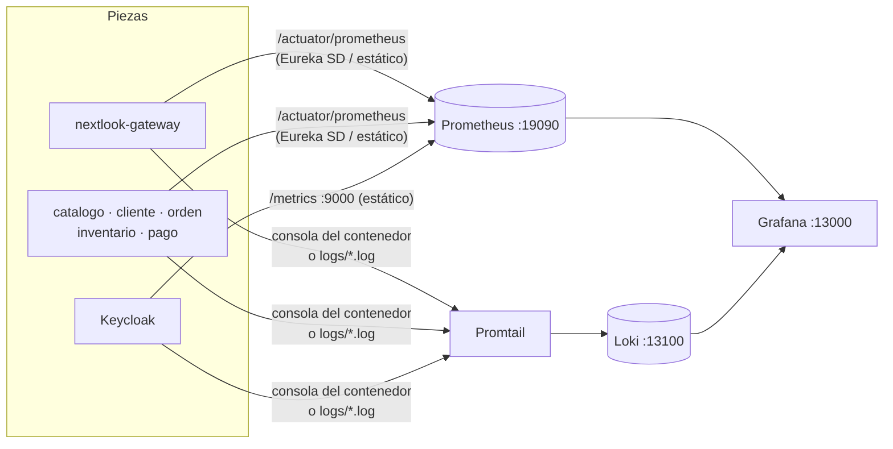

# Observabilidad (S10)

Métricas, logs y estado de salud de NextLook en un solo lugar: **Grafana** (`http://localhost:13000`, `admin`/`admin`), tablero **NextLook → NextLook - Diagnostico**, cargado automáticamente desde `obs/grafana/dashboards/`.

## Health groups

| Servicio | Liveness | Readiness |
|---|---|---|
| `catalogo-ms`, `cliente-ms`, `orden-ms`, `inventario-ms`, `pago-ms` | `/actuator/health/liveness` (`livenessState`) | `/actuator/health/readiness` (`readinessState` + **`db`**: su PostgreSQL) |
| Keycloak | `http://localhost:19000/health/live` | `http://localhost:19000/health/ready` |

`spring.datasource.hikari.connection-timeout: 3000` hace que, con la base caída, readiness responda `DOWN` (503) en ~3 s y no en 30 s. Prueba: `pwsh scripts/readiness-sin-base.ps1`.

## Correlación (`X-Trace-ID`)

1. **Gateway** (`CorrelationIdFilter`, WebMVC): si la petición no trae `X-Trace-ID`, lo crea y lo **agrega a la petición reenviada**.
2. **Microservicios** (`CorrelationIdFilter`): lo reutilizan y lo ponen en el MDC (`[traceId]` en cada línea de log).
3. **Feign** (`FeignAuthConfig` de `orden-ms`): lo reenvía a `cliente-ms` y `catalogo-ms` junto con el JWT.
4. **Kafka** (`EventoPublisher` + `TraceKafka`): el productor lo copia en el header `X-Trace-ID` del evento y cada `@KafkaListener` lo vuelve a poner en su MDC. Así la misma compra se sigue en `orden-ms → inventario-ms → pago-ms` aunque cruce hilos y servicios.

## Tablero "NextLook - Diagnostico"

| Panel | Fuente | Consulta |
|---|---|---|
| Servicios arriba | Prometheus | `up{job=~"nextlook-.*"}` |
| Peticiones HTTP por segundo | Prometheus | `sum by (application) (rate(http_server_requests_seconds_count{uri!~"/actuator.*"}[1m]))` |
| Errores 5xx por segundo | Prometheus | `sum by (application) (rate(http_server_requests_seconds_count{status=~"5..",uri!~"/actuator.*"}[1m]))` |
| Latencia promedio | Prometheus | `…seconds_sum / …seconds_count` por servicio |
| Eventos Kafka procesados por segundo | Prometheus | `sum by (application) (rate(spring_kafka_listener_seconds_count[1m]))` |
| Circuit Breakers de orden-ms | Prometheus | `resilience4j_circuitbreaker_state == 1` |
| Logs de NextLook | Loki | `{application=~"$servicio"} \|= "$texto"` |
| Seguir una compra por traceId | Loki | `{application=~".+"} \|= "$traceId"` |

## Falla simulada

`pwsh scripts/simular-falla.ps1` detiene `inventario-ms`, crea una orden durante la caída (queda en `PENDIENTE_STOCK` con el evento esperando en Kafka), lo vuelve a levantar y mide cuánto tarda la orden en avanzar. Con `-Servicio catalogo-ms` se prueba la falla síncrona (Circuit Breaker abierto y órdenes en `CARRITO`).
