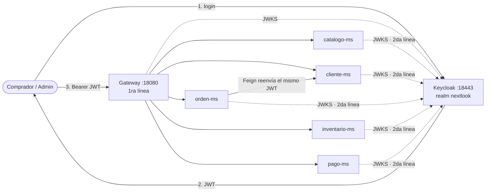

# Seguridad

Keycloak actúa como Identity Provider y emite JWT (realm `nextlook`, importado al arrancar desde `docker/keycloak/nextlook-realm.json`). La seguridad tiene **dos líneas** (S07):

1. **Gateway** (`nextlook-gateway`) valida firma y expiración del token y aplica las reglas por rol antes de enrutar.
2. **Cada microservicio implementado** vuelve a validar el JWT como *resource server* y repite sus reglas, así un llamado directo a su puerto (sin pasar por el Gateway) tampoco entra.

Los roles vienen en `realm_access.roles` y se convierten a `ROLE_CLIENTE` / `ROLE_ADMIN`.



## Realm `nextlook`

| Elemento | Valor |
|---|---|
| Cliente de la SPA | `nextlook-web` (público, Authorization Code + PKCE S256 obligatorio, **sin** password grant, redirect `http://localhost:4200/auth/callback`, web origin `http://localhost:4200`) — S11 |
| Cliente de scripts | `nextlook-api` (público, solo password grant para los `.ps1` de prueba, sin redirect URIs) |
| Claim propio | `talla_preferida` (user attribute + protocol mapper en ambos clientes) — S11 |
| Duración del token | 15 min |
| Usuarios de prueba | `cliente@nextlook.pe` / `cliente123` (CLIENTE), `cliente2@nextlook.pe` / `cliente123` (CLIENTE), `admin@nextlook.pe` / `admin123` (ADMIN) |

Obtener un token:

```bash
curl -s -X POST http://localhost:18443/realms/nextlook/protocol/openid-connect/token \
  -d grant_type=password -d client_id=nextlook-api \
  -d username=cliente@nextlook.pe -d password=cliente123
```

## Reglas por ruta (Gateway y microservicio)

| Ruta | Regla |
|---|---|
| `GET /api/v1/productos/**`, `GET /api/v1/categorias/**` | pública |
| resto de `/productos`, `/categorias` | `ADMIN` |
| `/api/v1/inventario/**` | `ADMIN` |
| `POST /api/v1/clientes`, `/api/v1/clientes/me/**` | `CLIENTE` |
| resto de `/api/v1/clientes/**` | `ADMIN` |
| `POST /api/v1/ordenes`, `/ordenes/mias`, `/ordenes/{id}/confirmar` | `CLIENTE` |
| `GET /api/v1/ordenes` | `ADMIN` |
| `GET /api/v1/ordenes/{id}` | `CLIENTE` dueño o `ADMIN` (dueño = `sub` del JWT, se valida en el servicio) |
| `POST /api/v1/pagos/procesar` | `CLIENTE` dueño de la orden |
| `GET /api/v1/pagos` | `ADMIN` |
| `/actuator/**`, Swagger | público (solo red interna) |

Sin token → **401**; token válido pero rol incorrecto o recurso ajeno → **403**.

`resenas-ms`, `envio-ms` y `notificaciones-ms` todavía no tienen endpoints, pero **ya validan el JWT** como el resto (sin token → 401). Verificación de los 8 servicios por su puerto directo: `pwsh scripts/prueba-seguridad.ps1`.
