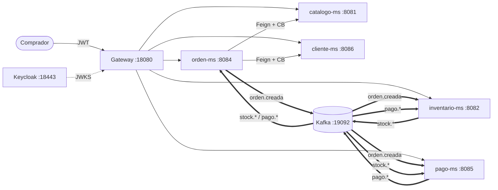

# Producto U2 — NextLook

**Sistema distribuido seguro, resiliente, consistente, observable e integrado con cliente frontend**, aplicado a la compra de ropa de NextLook. Sigue la estructura exigida por la [plantilla del Producto de Unidad 2](https://262dist.github.io/pagatu/proyecto-sello/u2-producto/), con el dominio propio del equipo en lugar del de `pagatu`.

## 1. Alcance de capacidades por sesión

| Sesión | Capacidad que agrega | Cómo está en NextLook | Cómo se verifica |
|---|---|---|---|
| S6 | Comunicación síncrona resiliente | `orden-ms` → `cliente-ms` y `catalogo-ms` por OpenFeign + Eureka, con **timeout** (2 s conexión / 3 s lectura), **reintentos** Resilience4j (3 intentos, *backoff* 400 → 800 ms, solo ante fallos de infraestructura), **Circuit Breaker** y **fallback** a `CARRITO` (HTTP 202) + `POST /ordenes/{id}/confirmar`. | `scripts/prueba-resiliencia.ps1` |
| S7 / S07b | Seguridad distribuida | Keycloak (realm `nextlook`, roles `CLIENTE`/`ADMIN`). El Gateway valida el JWT **y cada uno de los 8 microservicios también** (*resource server*), con reglas por rol y control de dueño por `sub`. | `scripts/prueba-seguridad.ps1` |
| S8 | Mensajería asíncrona | Kafka (KRaft): `orden.creada`, `stock.reservado`/`stock.rechazado`, `pago.aprobado`/`pago.rechazado`, publicados *after-commit* con key `ordenId`. Ningún servicio llama por HTTP a otro dentro de la Saga. | `scripts/simular-falla.ps1` |
| S9 | Consistencia eventual, compensación e idempotencia | Saga coreografiada orden → stock → pago; compensaciones (liberar stock, cancelar orden, anular pago); consumidores idempotentes (consulta + `UNIQUE`). | `scripts/prueba-saga.ps1`, `scripts/prueba-idempotencia.ps1` |
| S10 | Observabilidad | *Health groups* liveness/readiness (con `db`), Prometheus + Loki/Promtail + Grafana (tablero **NextLook - Diagnostico**), `X-Trace-ID` por HTTP, Feign y Kafka. | `scripts/simular-falla.ps1`, `scripts/readiness-sin-base.ps1` |
| S11 | Cliente frontend por el Gateway | SPA Angular 22 (`frontend/`): login *Authorization Code* + PKCE (`nextlook-web`), CORS en el Gateway, rutas protegidas por rol, «Mis pedidos» con *polling*. | `scripts/verificar-s11.ps1` + recorrido en la SPA |
| S12 | Ensamble y sustentación | Este documento + [guion de demo](#4-guion-de-la-demo-s12). | — |

### Aporte por integrante

| Integrante | Microservicios | Aporte en U2 |
|---|---|---|
| Anghelo | `catalogo-ms`, `orden-ms` | Catálogo de prendas/variantes; órdenes con Feign + Retry + Circuit Breaker; inicio de la Saga. |
| Yeins | `inventario-ms`, `resenas-ms` | Reserva de stock todo-o-nada, idempotencia y compensación; `resenas-ms` protegido (esqueleto). |
| Daniel | `cliente-ms`, `pago-ms` | Perfil por `sub` y direcciones; pagos con pasarela simulada, idempotencia y eventos de resultado. |
| Johan | `envio-ms`, `notificaciones-ms` | Esqueletos protegidos con JWT; se completan en U3. |

Transversales (Gateway, Keycloak, Kafka, observabilidad y SPA): ajustar según quién los construyó.

## 2. Rúbrica de evaluación (con la evidencia de NextLook)

| Criterio | Peso | Qué exige el nivel A | Evidencia en NextLook | Calificación obtenida |
|---|---:|---|---|---:|
| 1. Comunicación con respuesta controlada ante fallos | 12% | Timeout, reintentos y *fallback* verificados en vivo ante una caída provocada. | `docker stop catalogo-ms` → 3 intentos (`component=resiliencia status=retry`) → 202 `CARRITO`; circuito `OPEN` en `/actuator/circuitbreakers` y en el panel de Grafana; al volver, `confirmar` → 201. | |
| 2. Seguridad distribuida y protección de rutas | 16% | Autenticación y autorización en **todos** los microservicios propios, no solo en el Gateway. | `prueba-seguridad.ps1` llama a los 8 puertos directos: sin token 401, CLIENTE en ruta de ADMIN 403, rol correcto 2xx. Dueño por `sub`: otra persona → 403. | |
| 3. Mensajería asíncrona desacoplada | 16% | Evento publicado y consumido, con los dos servicios verificados de forma independiente. | Con `inventario-ms` detenido, `orden-ms` sigue aceptando órdenes (201) y publicando; al levantarlo, consume lo pendiente. Kafka UI muestra los tres topics. | |
| 4. Consistencia, compensación e idempotencia | 16% | Fallo parcial **y** reprocesamiento del mismo evento, sin inconsistencia ni duplicidad. | Compensación: `FUND` → orden `CANCELADA` y stock devuelto; talla agotada → `SIN_STOCK`. Idempotencia: `prueba-idempotencia.ps1` reenvía 3 veces el mismo `orden.creada` y stock/reservas/pagos no cambian (`status=ignored`). | |
| 5. Logs, health, métricas y paneles | 12% | Panel con métricas, logs y *health* correlacionados entre servicios. | Tablero *NextLook - Diagnostico* (disponibilidad, peticiones, errores, latencia, Kafka, Circuit Breakers, reintentos, logs y logs por `traceId`); liveness/readiness; mismo `traceId` en 6 servicios. | |
| 6. Cliente frontend mediante Gateway | 8% | Cliente que consume la API **solo** por el Gateway, con sesión y rutas protegidas según rol. | SPA con `apiBaseUrl` = Gateway; PKCE sin *password grant*; `authGuard`/`rolGuard`; menú según rol; «Mis pedidos» reflejando la Saga. | |
| 7. Sustentación | 20% | Aporte individual claro y respuestas precisas. | Tabla de aporte por integrante + guion de la sección 4. | |

Nota final = suma de (Peso × Puntos) / 100 × 20.

## 3. Configuración por ambiente

| Clave | DEV (`*-dev.yml`, apps en el host) | PROD (`*-prod.yml`, dentro de Docker) |
|---|---|---|
| `spring.security.oauth2.resourceserver.jwt.jwk-set-uri` | `http://localhost:18443/realms/nextlook/protocol/openid-connect/certs` | `http://keycloak:8080/realms/nextlook/protocol/openid-connect/certs` |
| `spring.kafka.bootstrap-servers` | `localhost:19092` | `nextlook-kafka:9092` |
| `app.kafka.topic.*` | `orden-eventos`, `inventario-eventos`, `pago-eventos` | igual |
| `resilience4j.circuitbreaker.instances` | `cliente`, `catalogo` (solo `orden-ms`) | igual |

En `services/compose-dev.yml` las mismas claves se sobreescriben por variables de entorno (`SPRING_KAFKA_BOOTSTRAP_SERVERS`, `SPRING_SECURITY_OAUTH2_RESOURCESERVER_JWT_JWKSETURI`).

### Arquitectura del sistema de esta unidad



Detalle de la Saga y de la idempotencia en [Consistencia de datos](consistencia.md).

## 4. Guion de la demo (S12)

Todo levantado con:

```bash
docker compose -f docker/docker-compose.infra.yml -f services/compose-dev.yml -f obs/compose-dev.yml up -d --build
cd frontend && pwsh ./crear-frontend.ps1 && cd nextlook-web && npm start
```

| # | Min | Qué se muestra | Comando / pantalla | Criterio |
|---|---:|---|---|---|
| 1 | 1 | Pitch: de U1 (CRUD por Gateway) a U2 (seguro, resiliente, por eventos, observable, con SPA) | Diagrama de [Arquitectura](#arquitectura-del-sistema-de-esta-unidad) | 7 |
| 2 | 2 | Login PKCE y compra feliz en la SPA: *Separando tus prendas…* → *Listo para pagar* → `APRO` → *Pagado* | http://localhost:4200 | 6, 3 |
| 3 | 1 | Pago rechazado (`FUND`) → *Cancelado* y stock devuelto | SPA + «Pagos (admin)» | 4 |
| 4 | 1 | Seguridad en cada microservicio, saltándose el Gateway | `pwsh scripts/prueba-seguridad.ps1` | 2 |
| 5 | 2 | Caída de `catalogo-ms`: reintentos, circuito abierto, `CARRITO`, recuperación | `pwsh scripts/prueba-resiliencia.ps1` + Grafana | 1, 5 |
| 6 | 1 | Reenvío del mismo evento: nada se duplica | `pwsh scripts/prueba-idempotencia.ps1` | 4 |
| 7 | 2 | Caída de `inventario-ms`: la orden espera en Kafka y se completa sola; seguir la compra por `traceId` en Grafana | `pwsh scripts/simular-falla.ps1` | 3, 5 |

Si algo falla en vivo, el tablero de Grafana (S10) es lo primero que se abre: «Servicios arriba» y los logs por `traceId` dicen qué servicio y en qué paso.

## 5. Límites conocidos (para la sustentación)

- `pago-ms` usa una **pasarela simulada** (convención de titulares de Mercado Pago Sandbox); la API real se conecta implementando `PasarelaPago`.
- `resenas-ms`, `envio-ms` y `notificaciones-ms` solo validan JWT; su lógica llega en U3.
- El *polling* de la SPA es una decisión de alcance: SSE/WebSocket queda como mejora.
- Keycloak corre en `start-dev` (HTTP); TLS real es parte de la fase de producción.
