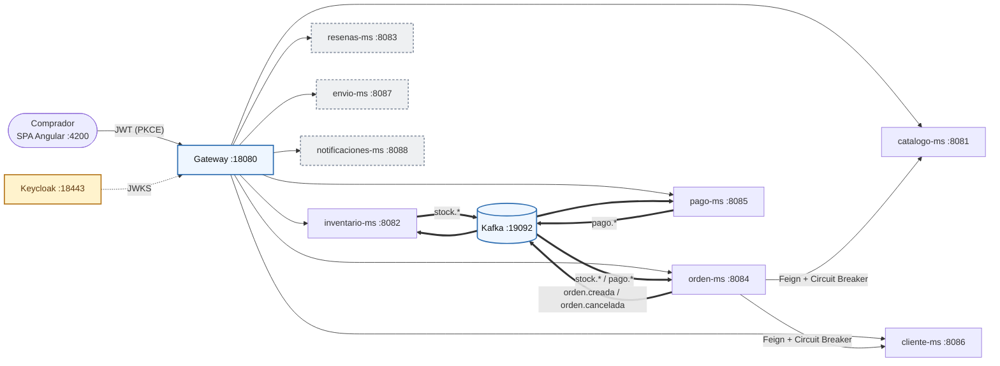
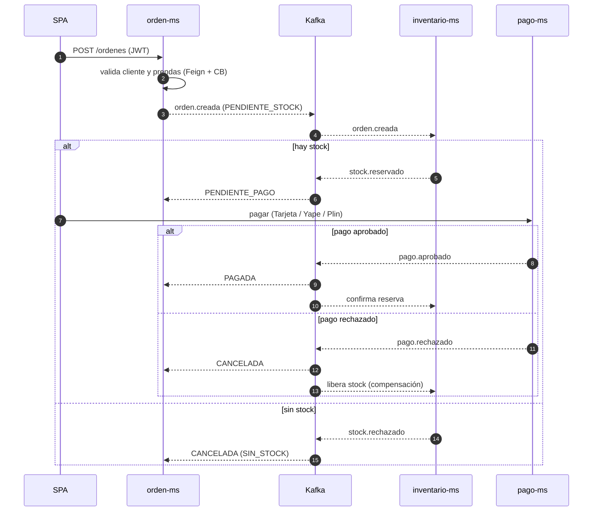
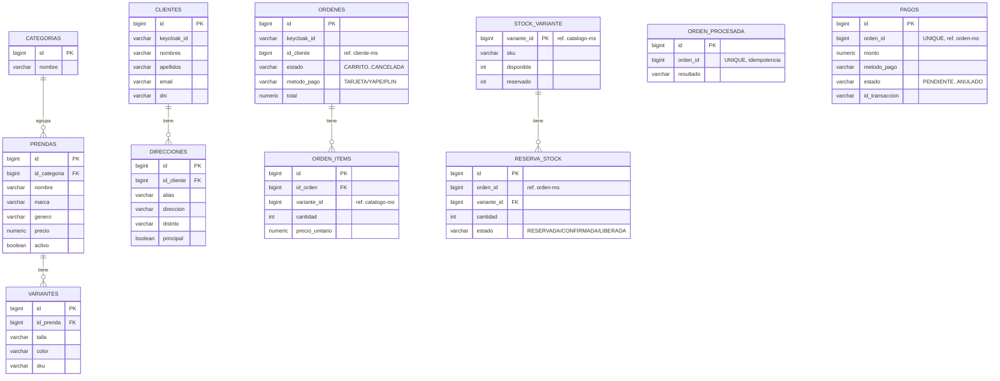
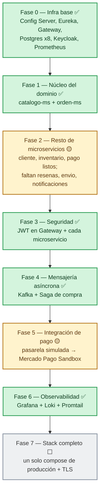

# NextLook


-231F20?logo=apachekafka&logoColor=white)


E-commerce de moda basado en **microservicios** — Proyecto Sello del curso de Sistemas Distribuidos.

Una tienda de ropa donde el cliente inicia sesión, elige prendas por talla y color, las paga con Tarjeta, Yape o Plin y sigue su pedido en «Mis pedidos». Por detrás, 8 microservicios Spring Boot se comunican por REST (con resiliencia) y por eventos Kafka (Saga coreografiada), protegidos con Keycloak y observados con Prometheus, Loki y Grafana.

> **Estado actual: cierre de la Unidad II (S06–S11).** Toda la documentación (arquitectura C4, seguridad, comunicación, consistencia, fichas de cada microservicio) está en [`NextLook/docs/`](NextLook/docs/index.md). Producto de la unidad y guion de la demo S12: [`NextLook/docs/u2-producto.md`](NextLook/docs/u2-producto.md).

---

## Contenido

- [Qué avanzamos](#qué-avanzamos)
- [Stack tecnológico](#stack-tecnológico)
- [Estado por componente](#estado-por-componente)
- [Estructura del repositorio](#estructura-del-repositorio)
- [Requisitos previos](#requisitos-previos)
- [Arranque rápido](#arranque-rápido)
- [Scripts de demo y verificación](#scripts-de-demo-y-verificación)
- [Arquitectura](#arquitectura)
- [Saga de compra](#saga-de-compra)
- [Modelo de datos](#modelo-de-datos)
- [Roadmap](#roadmap)
- [Límites conocidos](#límites-conocidos)
- [Equipo](#equipo)

---

## Qué avanzamos

### Unidad I — Base distribuida

- Config Server, Eureka y Gateway funcionando, con configuración por ambiente (`dev` / `prod`).
- Una base Postgres por microservicio y los 8 microservicios registrados en Eureka.
- Documentación de arquitectura servida con MkDocs.

### Unidad II — Sistema seguro, resiliente, consistente y observable

| Sesión | Capacidad | Cómo está en NextLook |
|---|---|---|
| **S06** – Comunicación síncrona resiliente | OpenFeign + Resilience4j | `orden-ms` llama a `cliente-ms` (perfil + dirección) y `catalogo-ms` (precio, talla, color) con timeout (2 s / 3 s), 3 reintentos con *backoff* y Circuit Breaker. Si fallan, la orden queda en `CARRITO` (HTTP 202) y se confirma después con `POST /ordenes/{id}/confirmar`. |
| **S07** – Seguridad distribuida | Keycloak + JWT | Realm `nextlook` importado automáticamente, roles `CLIENTE` / `ADMIN`. El Gateway **y cada uno de los 8 microservicios** validan el JWT (*resource server*); Feign reenvía el token; un cliente solo ve sus propias órdenes y pagos (control de dueño por `sub`). |
| **S08** – Mensajería asíncrona | Kafka 4 (KRaft) | Eventos `orden.creada`, `orden.cancelada`, `stock.reservado` / `stock.rechazado`, `pago.aprobado` / `pago.rechazado`, publicados *after-commit* con key `ordenId` en los topics `orden-eventos`, `inventario-eventos` y `pago-eventos`. Kafka UI incluido. |
| **S09** – Consistencia distribuida | Saga coreografiada | Orden → stock → pago, con compensaciones (liberar stock, cancelar orden, anular pago) y consumidores idempotentes (consulta previa + restricción `UNIQUE`). |
| **S10** – Observabilidad | Prometheus + Loki + Grafana | *Health groups* liveness / readiness, logs con `traceId` en Loki vía Promtail, `X-Trace-ID` propagado por Gateway, Feign y Kafka, y el tablero **NextLook - Diagnostico** en Grafana. |
| **S11** – Cliente frontend | SPA Angular 22 | Login *Authorization Code* + PKCE contra Keycloak (`nextlook-web`), consumo de la API **solo** por el Gateway (CORS), rutas protegidas por rol, bolsa, perfil y «Mis pedidos» con *polling*. |

**La tienda (SPA):**

- Catálogo de **22 prendas** con foto de referencia; solo `ADMIN` publica, cambia fotos o retira prendas.
- Pago paso a paso con **Tarjeta, Yape o Plin**.
- Opción «ya no quiero este pedido» con confirmación: dispara `orden.cancelada`, inventario libera las prendas y pago anula el cobro.
- Rediseño completo con estilo urbano y editorial.
- Panel de administración de productos y de pagos.

**Extras:** workflow de build en GitHub Actions (`.github/workflows/build.yml`) y un nombre de proyecto Compose único (`nextlook-dev`) para los tres archivos compose.

## Stack tecnológico

| Capa | Tecnología | Uso en NextLook |
|---|---|---|
| Backend | Java + Spring Boot | Los 8 microservicios de negocio |
| Infraestructura Spring Cloud | Config Server, Eureka, Spring Cloud Gateway | Configuración centralizada, descubrimiento y punto de entrada único |
| Comunicación síncrona | OpenFeign + Resilience4j | Llamadas REST con timeout, reintentos y Circuit Breaker |
| Comunicación asíncrona | Apache Kafka 4 (KRaft) + Kafka UI | Eventos de la Saga de compra |
| Seguridad | Keycloak + JWT | Login, roles `CLIENTE` / `ADMIN` y validación en Gateway y servicios |
| Persistencia | PostgreSQL + Flyway | Una base por microservicio, migraciones versionadas |
| Observabilidad | Prometheus, Loki, Promtail, Grafana | Métricas, logs centralizados con `traceId` y tablero de diagnóstico |
| Frontend | Angular 22 (SPA) | Tienda, bolsa, pago, «Mis pedidos» y panel de administración |
| Contenedores | Docker Compose | Levantar todo el entorno en local |
| CI | GitHub Actions | Build automático (`.github/workflows/build.yml`) |
| Documentación | MkDocs Material | Sitio de documentación en `NextLook/docs/` |

---

## Estado por componente

| Componente | Estado | Detalle |
|---|---|---|
| Config Server (`nextlook-config`) | ✅ | Sirve la configuración desde `infra/config-repo` y `services/*/config`. |
| Eureka (`nextlook-eureka`) | ✅ | `orden-ms` resuelve `cliente-ms` y `catalogo-ms` por nombre. |
| Gateway (`nextlook-gateway`) | ✅ | Rutas `/api/v1/**`, validación JWT y reglas por rol (1ra línea de defensa). |
| `catalogo-ms` | ✅ | Categorías, prendas, variantes talla/color, fotos y datos semilla (Flyway). |
| `cliente-ms` | ✅ | Perfil ligado al JWT (`keycloak_id`) + direcciones de envío. |
| `orden-ms` | ✅ | Feign + Circuit Breaker, inicio de la Saga, cancelación por el cliente. |
| `inventario-ms` | ✅ | Reserva todo-o-nada idempotente, confirmación y compensación. |
| `pago-ms` | 🟡 | Flujo de eventos completo con **pasarela simulada**; falta Mercado Pago Sandbox real. |
| `resenas-ms`, `envio-ms`, `notificaciones-ms` | 🟡 | Esqueletos protegidos con JWT (401/403); su lógica de negocio llega en U3. |
| Seguridad (Keycloak / JWT) | ✅ | Dos líneas de defensa: Gateway + cada microservicio. TLS real pendiente. |
| Mensajería (Kafka) | ✅ | 3 topics + Kafka UI. |
| Consistencia (Saga) | ✅ | Compensación e idempotencia verificadas con scripts. |
| Observabilidad | ✅ | Prometheus, Loki/Promtail, Grafana con tablero de diagnóstico. |
| Cliente web (Angular) | ✅ | PKCE, catálogo, bolsa, perfil, pago y «Mis pedidos». |

Detalle completo: [`NextLook/docs/avance.md`](NextLook/docs/avance.md).

---

## Estructura del repositorio

```text
NextLook/
├── .github/    # Workflow de build (GitHub Actions)
├── docker/     # docker-compose de la infraestructura + realm de Keycloak
├── docs/       # Documentación de arquitectura (MkDocs)
├── frontend/   # SPA Angular 22: login PKCE, catálogo, bolsa, pago, «Mis pedidos», admin
├── infra/      # Config Server, Eureka y Gateway
├── obs/        # Observabilidad: Prometheus, Loki, Promtail, Grafana
├── scripts/    # Scripts PowerShell de demo y verificación (Saga, seguridad, resiliencia…)
└── services/   # Los 8 microservicios de negocio
```

Cada carpeta principal tiene su propio `README.md` con el detalle de qué contiene y cómo se usa.

## Requisitos previos

| Herramienta | Para qué |
|---|---|
| [Docker Desktop](https://www.docker.com/products/docker-desktop/) (o Docker Engine + Compose v2) | Levantar infraestructura, bases de datos y microservicios |
| [Node.js](https://nodejs.org/) LTS y npm | Generar y ejecutar la SPA Angular |
| [PowerShell 7](https://learn.microsoft.com/powershell/scripting/install/installing-powershell) (`pwsh`) | Script del frontend y scripts de demo / verificación |
| Git | Clonar el repositorio |

> El stack completo levanta muchos contenedores (8 microservicios, 8 bases Postgres, Kafka, Keycloak y observabilidad). Asigna a Docker toda la memoria que puedas; con poca RAM los servicios tardan en quedar `UP` o se reinician.

```bash
git clone https://github.com/anghelo523/nextlook.git
cd nextlook/NextLook
```

---

## Arranque rápido

Desde la carpeta `NextLook/`:

```bash
docker compose \
  -f docker/docker-compose.infra.yml \
  -f services/compose-dev.yml \
  -f obs/compose-dev.yml \
  up -d --build
```

Levanta Config Server, Eureka, Gateway, Keycloak (realm `nextlook` ya importado), Kafka + Kafka UI, una base Postgres por microservicio, los 8 microservicios y la observabilidad.

Para la tienda:

```bash
cd frontend
pwsh ./crear-frontend.ps1
cd nextlook-web
npm start
```

| Servicio | URL |
|---|---|
| **Tienda (SPA Angular)** | http://localhost:4200 |
| Gateway | http://localhost:18080 |
| Eureka | http://localhost:18761 |
| Config Server | http://localhost:18888 |
| Keycloak | http://localhost:18443 (realm `nextlook`) |
| Kafka UI | http://localhost:18085 |
| Prometheus | http://localhost:19090/targets |
| Grafana | http://localhost:13000 (admin / admin) |
| catalogo-ms · inventario-ms · resenas-ms · orden-ms · pago-ms · cliente-ms · envio-ms · notificaciones-ms | 8081 → 8088 |

Cada microservicio expone `/actuator/health` y `/swagger-ui.html`.

**Usuarios de prueba:** `cliente@nextlook.pe` / `cliente123` (CLIENTE) y `admin@nextlook.pe` / `admin123` (ADMIN).

> **Desde el navegador, siempre `localhost`, nunca el nombre del contenedor.** `http://orden-ms:8084/...` solo resuelve *dentro* de la red de Docker; desde tu PC es `http://localhost:8084/...`.

**Documentación con MkDocs** (desde `NextLook/`):

```bash
docker run --rm -it -p 8000:8000 -v "${PWD}:/docs" squidfunk/mkdocs-material
```

Abre http://localhost:8000.

### Detener el entorno

```bash
# Detener los contenedores (los datos se conservan)
docker compose -f docker/docker-compose.infra.yml -f services/compose-dev.yml -f obs/compose-dev.yml down

# Detener y borrar también los volúmenes (bases de datos vuelven a los datos semilla)
docker compose -f docker/docker-compose.infra.yml -f services/compose-dev.yml -f obs/compose-dev.yml down -v
```

Para ver los logs de un servicio: `docker compose -f docker/docker-compose.infra.yml -f services/compose-dev.yml -f obs/compose-dev.yml logs -f <servicio>`.

---

## Scripts de demo y verificación

Todos en `NextLook/scripts/` (PowerShell 5+ o 7), con el stack levantado:

| Script | Qué demuestra |
|---|---|
| `prueba-saga.ps1` | Compra pagada (`APRO`), pago rechazado (`FUND`, con compensación de stock) y orden sin stock, entre otros casos. |
| `prueba-seguridad.ps1` | Llama directo a los 8 puertos: sin token → 401, CLIENTE en ruta de ADMIN → 403, rol correcto → 2xx. |
| `prueba-resiliencia.ps1` | Caída de `catalogo-ms`: reintentos, circuito abierto, orden en `CARRITO` y recuperación. |
| `prueba-idempotencia.ps1` | Reenvía 3 veces el mismo `orden.creada`: stock, reservas y pagos no cambian. |
| `simular-falla.ps1` | Caída de `inventario-ms`: la orden espera en Kafka y se completa sola; seguimiento por `traceId` en Grafana. |
| `readiness-sin-base.ps1` | Readiness cae a `DOWN` cuando el servicio pierde su base de datos. |
| `verificar-s11.ps1` | Verificación del cliente frontend (PKCE, CORS, token con `talla_preferida`). |

---

## Arquitectura



Flechas simples = REST por el Gateway; flechas gruesas = eventos Kafka. Los servicios con borde punteado son esqueletos protegidos (U3). Todos se registran en Eureka y leen su configuración del Config Server.

Más detalle: [Comunicación](NextLook/docs/comunicacion.md) · [Seguridad](NextLook/docs/seguridad.md) · [Observabilidad](NextLook/docs/observabilidad.md) · [Cliente web](NextLook/docs/frontend.md).

---

## Saga de compra



Si el cliente cancela («ya no quiero este pedido»), `orden.cancelada` hace que inventario libere las prendas y pago anule el cobro. Detalle en [Consistencia de datos](NextLook/docs/consistencia.md).

---

## Modelo de datos

Implementado con Flyway en los 5 microservicios con lógica de negocio. Cada servicio es dueño de su propia base: no hay FK entre servicios (las referencias cruzadas son ids lógicos resueltos por REST o eventos).



---

## Roadmap



**Siguiente (Unidad III):** lógica de `resenas-ms`, `envio-ms` y `notificaciones-ms`; Mercado Pago Sandbox real; TLS en Keycloak; un único compose de producción.

---

## Límites conocidos

- `pago-ms` usa una **pasarela simulada** (convención de titulares de Mercado Pago Sandbox: `APRO`, `FUND`…); la API real se conecta implementando `PasarelaPago`.
- `resenas-ms`, `envio-ms` y `notificaciones-ms` solo validan JWT; su lógica llega en U3.
- «Mis pedidos» usa *polling*; SSE / WebSocket queda como mejora.
- Keycloak corre en `start-dev` (HTTP); TLS real es parte de la fase de producción.

### Trabajo en otras ramas

- **`avance-emer`** (Johan): avance de S07 sobre la plantilla del curso, con un `auth-ms` propio (login y registro de usuarios con JWT RS256, JWKS y el Gateway como Resource Server). Todavía no está integrado en `main`.

---

## Equipo

| Integrante | Microservicios | Aporte en U2 |
|---|---|---|
| Anghelo | `catalogo-ms`, `orden-ms` | Catálogo de prendas y variantes; órdenes con Feign + Retry + Circuit Breaker; inicio de la Saga. |
| Yeins | `inventario-ms`, `resenas-ms` | Reserva de stock todo-o-nada, idempotencia y compensación; `resenas-ms` protegido. |
| Daniel | `cliente-ms`, `pago-ms` | Perfil por `sub` y direcciones; pagos con pasarela simulada, idempotencia y eventos de resultado. |
| Johan | `envio-ms`, `notificaciones-ms` | Esqueletos protegidos con JWT (se completan en U3); avance de autenticación en `avance-emer`. |

**Docente:** Abel Angel Sullon Macalupu — Curso de Sistemas Distribuidos.
